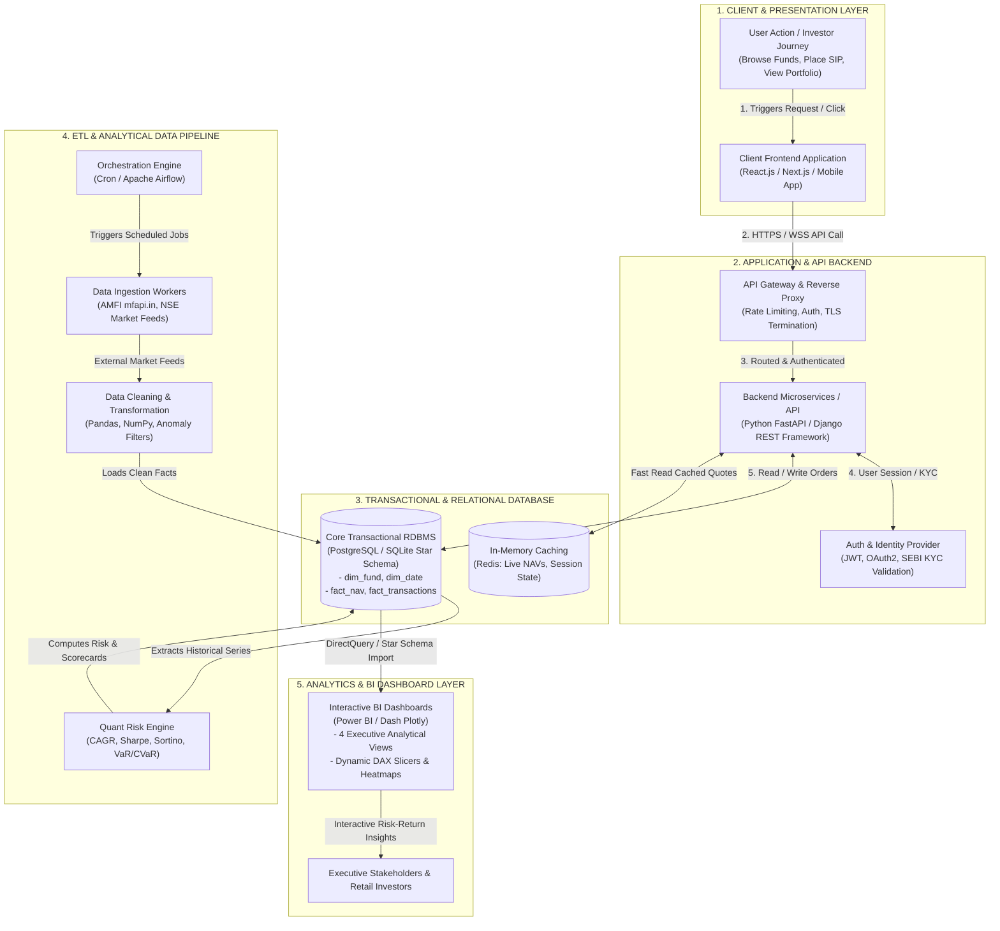

# Week 2 — Full-Stack FinTech Software Architecture

**Topic:** Software Architecture Fundamentals  
**Author:** Mayank Soni (Data Analyst Intern)  
**Organization:** Bluestock Fintech  

---

## 1. System Architecture Flow Diagram

---

## 2. Component Explanations

1. **User Action:** Retail investors, wealth managers, or institutional clients initiate actions such as searching schemes, triggering SIP mandates, or viewing portfolio risk profiles.
2. **Frontend Layer:** Responsive single-page application built with modern web technologies delivering sub-100ms UI responsiveness, real-time charting, and interactive order tickets.
3. **Backend / API Gateway:** Handles authorization, request throttling, and routing to transactional microservices. Validates client payloads and guarantees idempotent financial order execution.
4. **Relational Database Layer:** High-integrity relational database enforcing ACID properties, foreign key constraints, and indexing. Implements a star schema optimized for fast analytical aggregations.
5. **ETL & Data Pipeline:** Automated pipeline orchestrating ingestion from external exchanges and AMFI endpoints, executing data cleaning, and calculating quantitative risk scores.
6. **Analytics Dashboard Layer:** High-impact business intelligence dashboards providing executive visibility into AUM trends, Sharpe-ranked fund scorecards, investor cohorts, and downside risk metrics.
